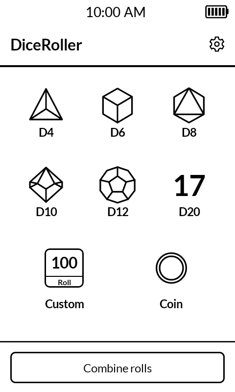
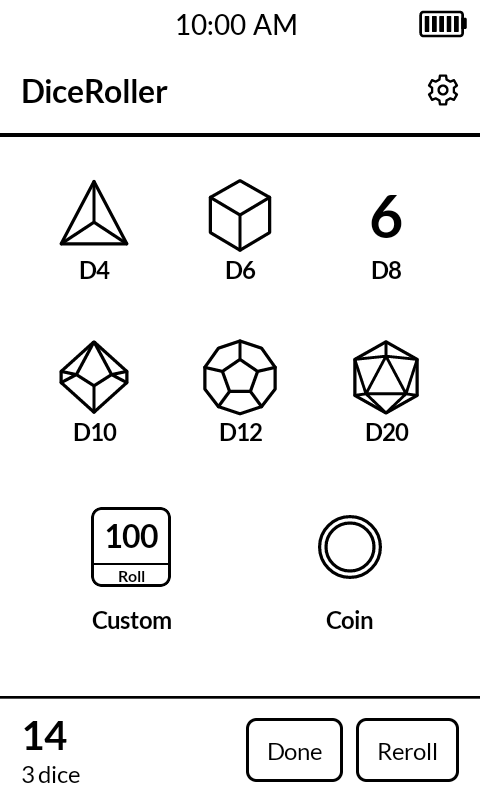

# DiceRoller

An offline dice roller for the Mudita Kompakt and its E Ink screen.

  
  
  
  

## Features

- Roll D4, D6, D8, D10, D12, D20, a coin or a custom die with 2–9999 sides.
- A result replaces the tapped icon for five seconds. Tap again for another roll.
- Combine rolls into a set with a total and count. Reroll repeats the same set; Done starts fresh.
- Tap the Custom icon to edit its range; tap the Custom label to roll.
- Optional vibration, dark theme and keep screen on, released after ten minutes without an action.
- 63 languages. Follow your phone's language or choose one in Settings.
- Fully offline. No account, ads, tracking or permissions.

Settings are saved on your phone. Rolls and combined sets are not saved to disk.

## Install

The first public release is being prepared. No production APK is published yet.
Once available, signed APKs and their checksums will be attached to
[GitHub Releases](https://github.com/dkarski/diceroller/releases).
See [SECURITY.md](SECURITY.md) for download verification.

Requires Android 12 or later. Designed and tested for Mudita Kompakt.

## Support and contact

DiceRoller is free. If you enjoy it, you can [leave a tip on Ko-fi](https://ko-fi.com/danielkarski).
Tips are voluntary and unlock nothing.

For bugs and ideas, open an [issue](https://github.com/dkarski/diceroller/issues) or email
daniel.karski5q@gmail.com. Translation corrections are welcome; see
[Translations](docs/TRANSLATIONS.md).

## Privacy and license

DiceRoller collects no data. See the [Privacy Policy](docs/PRIVACY_POLICY.md) and
[Terms of Use](docs/TERMS_OF_USE.md).

Copyright 2026 Daniel Karski. Licensed under the [Apache License 2.0](LICENSE).
The application shell is adapted from Lifepoints and Kompakt App Template; see [NOTICE](NOTICE).

To build the app or contribute, see [CONTRIBUTING.md](CONTRIBUTING.md).
