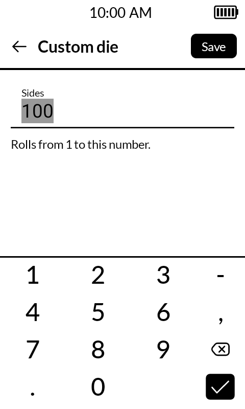
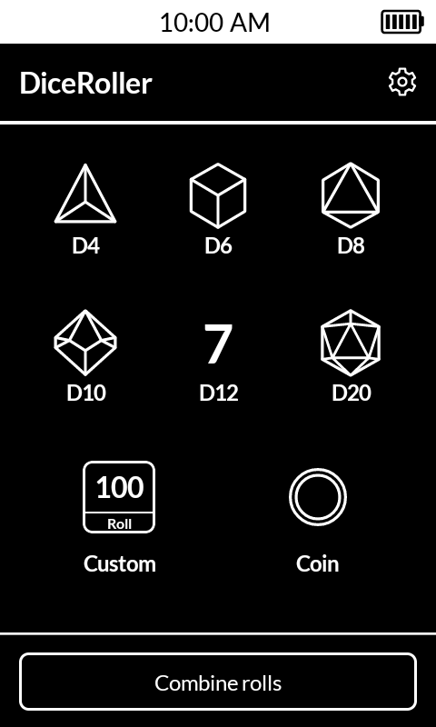

# DiceRoller

An offline dice roller for tabletop games, with standard dice, a coin and custom ranges.
Made for the [Mudita Kompakt](https://mudita.com/products/phones/mudita-kompakt/) and its E Ink screen.

  
  
  
  

## Features

- Opens straight on the dice, ready to roll.
- Tap D4, D6, D8, D10, D12, D20 or Coin. The result replaces the icon for five seconds.
- Combine rolls to see a total and count. Reroll repeats the same set; Done starts a new one.
- Tap the Custom icon to set 2–9999 sides, or tap its label to roll. Changing the range keeps earlier rolls as they were.
- A short vibration confirms each roll. You can turn it off in Settings.
- Optional dark theme and keep screen on. The screen is released after ten minutes without an action.
- Settings are saved on your phone. Rolls and combined sets are not saved to disk.
- 63 languages. The app follows the phone's language, or you can choose one in Settings.
- Fully offline. No account, ads, tracking or permissions.

A separate roll history and more dice looks are planned.

## Install

Install DiceRoller from [InkApps](https://inkapps.mudita.com/) on your Kompakt, or download the APK from
[GitHub Releases](https://github.com/dkarski/diceroller/releases/latest). Both are signed with the same key, so you can
update from either source without losing your settings. To verify a download, see [SECURITY.md](SECURITY.md).

Requires Android 12 or later.

## Support and contact

DiceRoller is free. If you enjoy it, you can leave a tip:

For bugs and ideas, open an [issue](https://github.com/dkarski/diceroller/issues) or email
daniel.karski5q@gmail.com.

## Privacy and license

DiceRoller collects no data. See the [Privacy Policy](docs/PRIVACY_POLICY.md) and [Terms of Use](docs/TERMS_OF_USE.md).

Copyright 2026 Daniel Karski. Licensed under the [Apache License 2.0](LICENSE).
The application shell is adapted from Lifepoints and Kompakt App Template; see [NOTICE](NOTICE).

To build the app or contribute, see [CONTRIBUTING.md](CONTRIBUTING.md).

